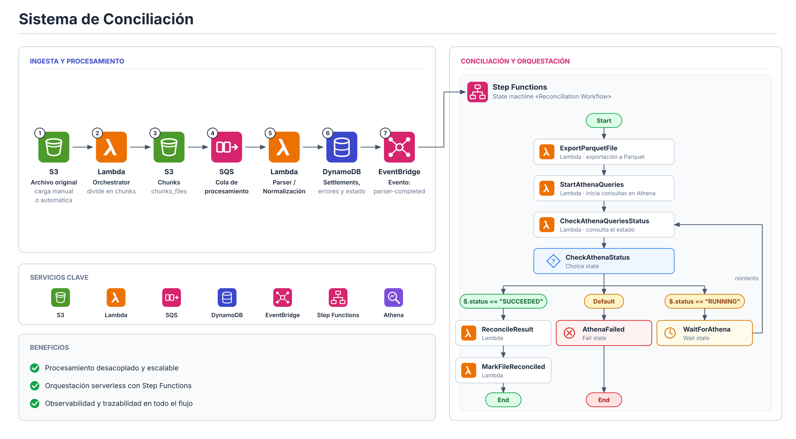

# Conciliation Platform

Sistema de conciliación de archivos de liquidaciones (*settlements*) contra transacciones propias, construido 100 % serverless sobre AWS. Procesa archivos grandes en paralelo, detecta diferencias entre lo que reporta el proveedor de pagos y lo que registró la fintech, y deja el resultado trazable por archivo.

> Proyecto personal de portafolio. Los datos usados son de prueba.



## Qué resuelve

Un proveedor de pagos envía un archivo con las liquidaciones del día. La plataforma lo valida, lo normaliza y lo cruza contra las transacciones de la fintech para clasificar cada registro:

| Resultado | Significado |
|---|---|
| `MATCHED` | La liquidación coincide con la transacción (monto, moneda y proveedor). |
| `MISMATCH` | Existe en ambos lados pero difiere en monto, moneda o proveedor. |
| `UNMATCHED_BANK_ONLY` | Está en la liquidación pero no hay transacción en la ventana de búsqueda. |
| `UNMATCHED_FINTECH_ONLY` | Transacción `PENDING` vencida que nunca apareció en una liquidación. |
| `DECLINED` | Liquidación con estado distinto de `SETTLED`. |

## Arquitectura

```
S3 (archivo) → Lambda orquestadora → S3 (chunks .csv.gz) → SQS → Lambda normalize-parser
                                                                      │
                                                                      ▼
                                                              DynamoDB (estado)
                                                                      │  último chunk completado
                                                                      ▼
                                                      EventBridge ("parserCompleted")
                                                                      │
                                                                      ▼
                                                  Step Functions · Reconciliation Workflow
```

### Flujo de punta a punta

1. Se sube un archivo a S3 (manual o automático).
2. Una Lambda orquestadora lo divide en *chunks* comprimidos (`.csv.gz`) y publica cada uno en SQS. *(Esta Lambda todavía no está incluida en este repositorio.)*
3. `normalize-parser` consume cada chunk, lo descomprime en streaming, valida y normaliza las filas, y guarda *settlements* válidos y errores en DynamoDB.
4. El chunk que completa el archivo dispara un evento `parserCompleted` en EventBridge, que inicia la máquina de estados.
5. Step Functions exporta los *settlements* a Parquet, lanza las consultas en Athena, espera con polling, aplica los resultados y marca el archivo como conciliado.

### Máquina de estados

```
ExportParquetFile → StartAthenaQueries → CheckAthenaQueriesStatus → CheckAthenaStatus (Choice)
                                                                      ├─ SUCCEEDED → ApplyResults → MarkFileReconciled → End
                                                                      ├─ RUNNING   → Wait 10 s → CheckAthenaQueriesStatus
                                                                      └─ FAILED / Default → AthenaFailed (Fail)
```

Cada tarea Lambda tiene política de *retry* con backoff exponencial (`IntervalSeconds: 5`, `BackoffRate: 2`; 3 reintentos en la exportación y 2 en el resto).

## Componentes

| Carpeta | Función | Empaquetado |
|---|---|---|
| `lambdas/normalize-parser` | Procesa chunks desde SQS: descomprime, parsea, valida y persiste. Publica el evento al finalizar el archivo. | Imagen de contenedor (ECR) |
| `lambdas/exporter-parquet` | Lee los *settlements* del archivo desde DynamoDB (paginado) y escribe un Parquet en S3. | Imagen de contenedor (ECR) |
| `lambdas/start-queries-athena` | Lanza las 4 consultas de conciliación en Athena. | ZIP |
| `lambdas/check-athena-queries-status` | Consolida el estado de las consultas en `RUNNING`, `SUCCEEDED` o `FAILED`. | ZIP |
| `lambdas/apply-results` | Descarga los CSV de resultados de Athena y los escribe en DynamoDB. | ZIP |
| `lambdas/mark-file-reconciled` | Valida totales y marca el archivo como `RECONCILED`. | ZIP |

Runtime: Python 3.13. Dependencias principales: `boto3`, `pyarrow`, `aws-lambda-powertools`.

## Idempotencia y consistencia

Reprocesar el mismo archivo, o recibir un mensaje de SQS duplicado, no duplica resultados:

- **Registro de chunks con lease.** Un chunk solo se procesa si no existe, si falló, o si su procesamiento quedó abandonado (más de 300 s sin actualizar). Se garantiza con una escritura condicional en DynamoDB. Un chunk ya `COMPLETED` o en curso se omite.
- **Escrituras determinísticas.** Las claves de los *settlements* y de los resultados de conciliación se derivan de sus IDs (`SETTLEMENT#<id>`, `RECONCILIATION#<regla>#…`), así que reescribirlos sobrescribe el mismo ítem.
- **Cierre del chunk en una transacción.** Marcar el chunk como `COMPLETED` y sumar los totales del archivo ocurre en una sola `TransactWriteItems`.
- **Finalización exactamente una vez.** El archivo pasa de `CREATED` a `COMPLETED` con una condición (`processed_chunks = total_chunks`); solo el chunk que lo logra publica el evento.
- **Control de totales.** `mark-file-reconciled` solo marca el archivo si la cantidad de registros clasificados coincide con `records_successful`. Si no, falla con `TotalsMismatchError`.

## Modelo de datos (DynamoDB, tabla única)

| PK | SK | Contenido |
|---|---|---|
| `FILE#<file_id>` | `INFO` | Estado del archivo, totales, contadores de conciliación |
| `FILE#<file_id>` | `CHUNK#<chunk_id>` | Estado del chunk (`PROCESSING`, `COMPLETED`, `FAILED`), intentos, último error |
| `FILE#<file_id>` | `SETTLEMENT#<settlement_id>` | Liquidación normalizada |
| `FILE#<file_id>` | `RECONCILIATION#<regla>#<TXN\|SETTLEMENT>#<id>` | Resultado de una regla de conciliación |

## Reglas de conciliación (Athena)

`start-queries-athena` ejecuta cuatro consultas por archivo sobre las tablas `settlements` (Parquet) y `transactions` (particionada por `year/month/day`):

- `unmatched_bank_only`, `unmatched_fintech_only`, `mismatch` y `summary`.
- **Ventana de búsqueda:** fecha de la liquidación y los 7 días anteriores (`LOOKBACK_DAYS = 7`).
- **Tolerancia de monto:** diferencias mayores a `0.005` se consideran discrepancia.
- El estado consolidado es `FAILED` si alguna consulta falló o fue cancelada, `SUCCEEDED` si todas terminaron, y `RUNNING` en cualquier otro caso (incluye `QUEUED`).

## Formato de entrada

Archivos CSV comprimidos (`.csv.gz`) con estas columnas:

`settlement_id`, `transaction_reference`, `provider_name`, `currency`, `settlement_status`, `settled_amount`, `settlement_date` (`YYYY-MM-DD HH:MM:SS`).

Las claves de S3 siguen el prefijo `year=YYYY/month=MM/day=DD/…`, del que se obtiene la fecha de liquidación. Las filas inválidas no detienen el proceso: se guardan como errores junto con su fila de origen y su número de fila.

## Variables de entorno

| Variable | Usada por | Descripción |
|---|---|---|
| `CONCILIATION_TABLE_NAME` | todas las Lambdas con DynamoDB | Tabla principal |
| `BUS_EVENT` | `normalize-parser` | Bus de EventBridge donde se publica `parserCompleted` |
| `BUCKET_NAME` | `exporter-parquet` | Bucket de destino de los Parquet |
| `ATHENA_DATABASE` | `start-queries-athena` | Base de datos de Athena |
| `ATHENA_OUTPUT_LOCATION` | `start-queries-athena` | Ubicación S3 de resultados de Athena |
| `ATHENA_RESULTS_PREFIX` | `apply-results` | Bucket de resultados (por defecto `conciliation-parquet-files`) |
| `TMP_DIRECTORY` | `apply-results` | Directorio temporal (por defecto `/tmp`) |

## Observabilidad

Logs estructurados en JSON con AWS Lambda Powertools. Cada ejecución incluye `file_id` como clave de correlación, y se registran eventos como `chunk_processed`, `file_finalized`, `athena_queries_started`, `rule_applied` y `file_reconciled`, con duraciones, conteos y bytes escaneados por Athena. Todo se consulta en CloudWatch Logs.

## Despliegue

Cada Lambda incluye un workflow de GitHub Actions (`deployment.yaml.disabled`) para desplegar en `us-east-1`. Están desactivados; para usarlos, renómbralos a `.yaml`, configura `AWS_ACCESS_KEY_ID` y `AWS_SECRET_ACCESS_KEY` como *secrets* del repositorio y revisa los nombres de funciones y repositorios ECR.

`normalize-parser` y `exporter-parquet` se construyen como imágenes Docker:

```bash
cd lambdas/normalize-parser
docker build -t conciliation-worker .
```

## Estado y próximos pasos

- [ ] Timeout global y límite de reintentos para el polling de Athena
- [ ] Cola de mensajes fallidos (DLQ) en SQS
- [ ] Alarmas en CloudWatch (fallos de la máquina de estados, DLQ, errores de Lambda)
- [ ] `Catch` en la máquina de estados para marcar el archivo como fallido
- [ ] Infraestructura como código (SAM, CDK o Terraform) y la definición de la máquina de estados versionada en el repo
- [ ] Extraer `shared_layer` a una Lambda Layer única (hoy está copiada en dos Lambdas debido a que las lambdas estan dockerizadas)
- [ ] Tests unitarios
